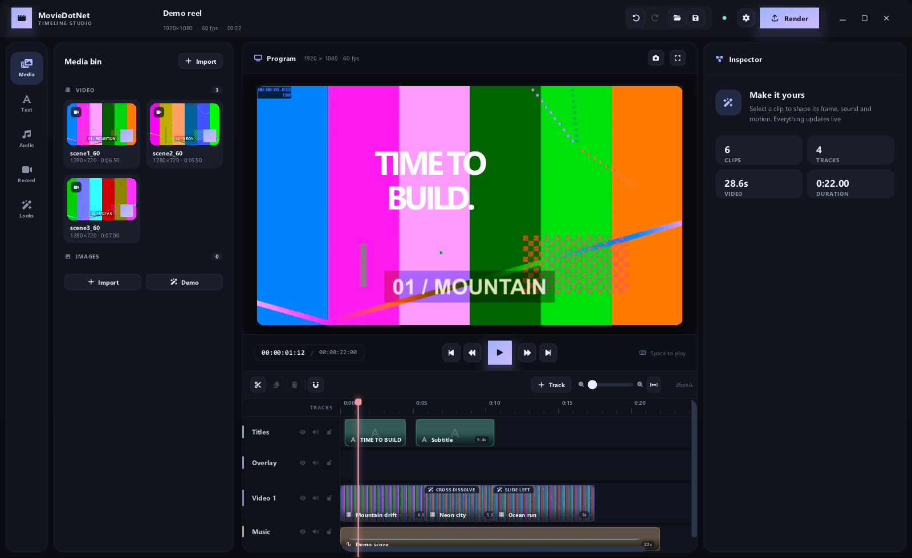

# MovieDotNet documentation

MovieDotNet is a cross-platform non-linear video editor built with the
[Donkeh](https://barely-sentient.github.io/donkeh-ui) UI framework and FFmpeg.
The UI is C# + CSS; FFmpeg does probing, thumbnails, waveforms, Windows capture
and the final render.



[**Download the latest release**](https://github.com/barely-sentient/moviedotnet/releases/latest) **— requires .NET 10 Runtime** for desktop. Windows, Linux, macOS and Android assets are published together.

## What it does

- Five calm destinations: **Media**, **Text**, **Audio**, **Record**, **Looks**.
- A zoomable multi-track timeline with trim, split, duplicate, delete, snapping,
  transitions and per-track hide/mute/lock.
- A live Program monitor with layer selection, move, resize and rotation.
- A progressive-disclosure inspector: frame, opacity and audio first, then
  **More controls** for timing, rotation, motion, transitions and effects.
- Drag and drop from the media bin, audio list or title presets onto any
  timeline lane.
- Screen, window, camera and microphone capture on Windows through FFmpeg,
  fitted to the project canvas.
- A frameless desktop window with a custom title bar and native window controls.
- Export to H.264/AAC MP4 with resolution and frame-rate presets, CRF quality,
  progress, cancellation and an FFmpeg log.

## Documentation map

| Page | What it covers |
| --- | --- |
| [Getting started](getting-started.md) | Requirements, running, first project, demo reel, saving. |
| [Editing](editing.md) | Media bin, timeline, preview, inspector, text, audio, Looks, drag and drop. |
| [Capture](capture.md) | Screen, window, camera and microphone recording; canvas fitting. |
| [Export](export.md) | Render settings, codecs, progress, frame snapshots and output folders. |
| [Window and mobile](window-and-mobile.md) | Frameless desktop chrome and the Android phone shell. |
| [Architecture](architecture.md) | Store, undo, threading, FFmpeg pipeline, render graph and framework integration. |
| [Framework changes](framework-changes.md) | Donkeh changes shipped in the NuGet dependency the app uses. |
| [Troubleshooting](troubleshooting.md) | Missing FFmpeg, capture problems, render failures and platform limits. |
| [Screenshots](screenshots.md) | The visual tour and where each screen appears. |

## At a glance

| Item | Value |
| --- | --- |
| Default canvas | 1920 × 1080 |
| Default project frame rate | 60 fps |
| Export frame-rate choices | 24, 25, 30, 50, 60 |
| Project files | `Documents/MovieDotNet/Projects/*.mdproj` |
| Renders | `Documents/MovieDotNet/Renders` |
| Recordings | `Documents/MovieDotNet/Recordings` |
| Media derivatives cache | `<local app data>/MovieDotNet/cache` |

## Quick start

```powershell
# from the repository root
dotnet run -f net10.0
```

Press **Import** to choose media, or **Demo** to generate a self-contained demo
reel. See [Getting started](getting-started.md) for requirements and the full
first-run flow.
