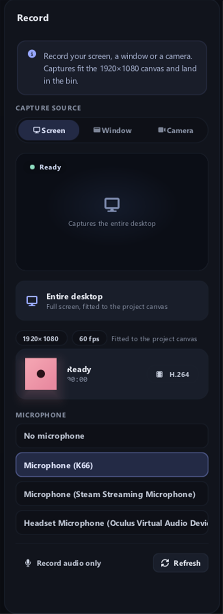
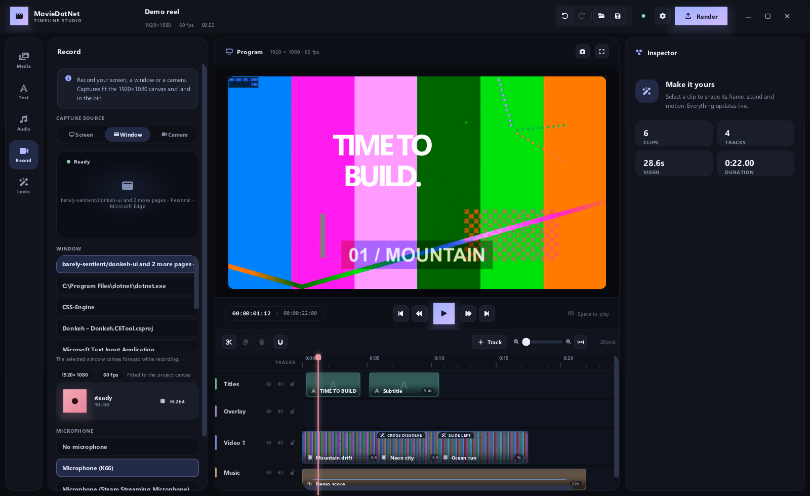

# Capture



The **Record** rail records a screen, a window, a camera or a microphone through
FFmpeg. Every video capture is fitted to the project canvas before it lands in
the bin.

## Sources

| Source | What it records | Notes |
| --- | --- | --- |
| **Screen** | The entire visible desktop. | The window may be moved or minimised; the recording continues. |
| **Window** | The client area of a visible top-level window. | The selected window is brought forward so its composited pixels are captured. Return to MovieDotNet to stop. |
| **Camera** | A DirectShow camera. | The camera must support the requested 1920×1080 input, or FFmpeg may reject it. |
| **Audio only** | The selected microphone. | A separate recording action under the microphone picker. |

The window list excludes MovieDotNet's own window. Minimised and tool windows
are not listed. Use **Refresh** after opening or closing windows.



## Canvas fitting

Video captures are encoded at the **project canvas** size (1920 × 1080 by
default) and the **project frame rate** (60 fps by default). The FFmpeg filter
chain scales the source to fit inside the canvas with its aspect ratio preserved
and pads the remainder with black:

```
scale=W:H:force_original_aspect_ratio=decrease,
pad=W:H:(ow-iw)/2:(oh-ih)/2:color=black,
setsar=1
```

A 4K desktop is scaled down; a small window is scaled up. Nothing is cropped.

Screen capture deliberately does **not** pass `video_size` to `gdigrab`; that
option crops the desktop region instead of scaling the full frame. Window
capture does crop the desktop to the window's client rectangle, because that is
the only reliable way to capture a GPU-composited window with `gdigrab`.

## Microphone

- Choose a microphone from the **Microphone** list, or **No microphone** for a
  silent video capture.
- **Record audio only** records just the microphone.
- The microphone list updates when you press **Refresh**.

## Output

Recordings are written to:

```
Documents/MovieDotNet/Recordings
```

Video recordings are H.264/AAC MP4 files. Audio-only recordings are M4A. When a
recording stops, it is analysed, added to the media bin and selected. Video
captures are placed on the timeline automatically; audio-only captures are
added to the bin.

## Limitations

- **Window capture and occlusion.** Window capture reads the visible screen
  region occupied by the window. The selected window is brought to the front
  when recording starts; if it is later covered, the cover is recorded. This is
  the same limitation as a screen crop, and avoids the blank frames that
  `gdigrab` produces from GPU-composited window surfaces.
- **Protected content.** DRM-protected or hardware-overlay windows may capture
  black. Use screen capture with the content visible, or choose another source.
- **Virtual cameras.** Camera enumeration lists DirectShow devices. Virtual
  cameras that do not expose a usable DirectShow stream will fail with an FFmpeg
  error in the toast/log.
- **Mobile.** FFmpeg and ffprobe are desktop executables; recording, import and
  render stay desktop features. Android can open projects, play and edit.
