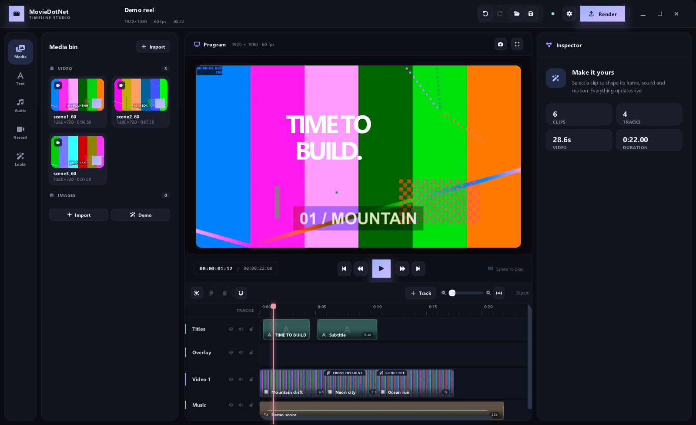
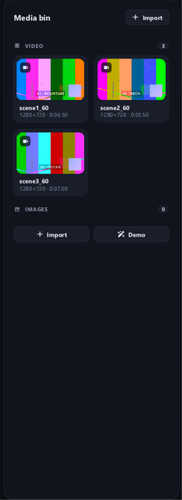
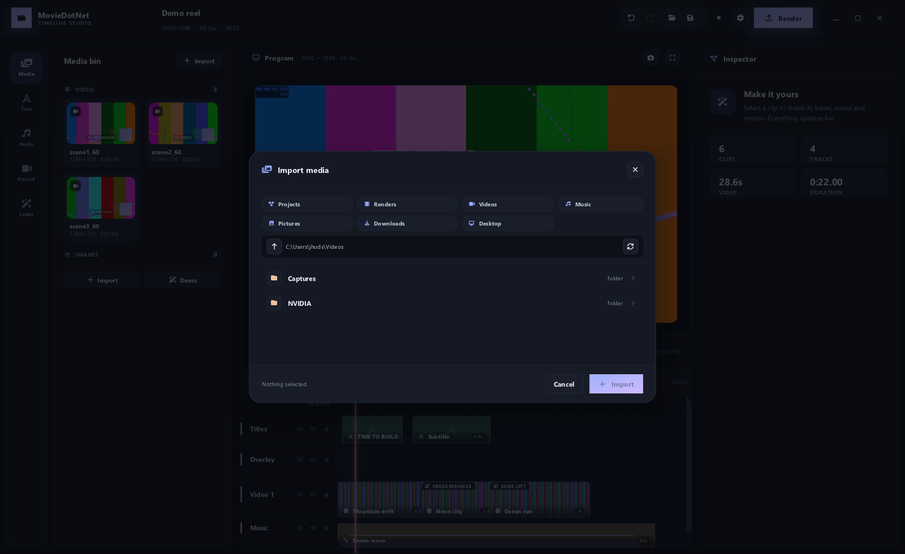
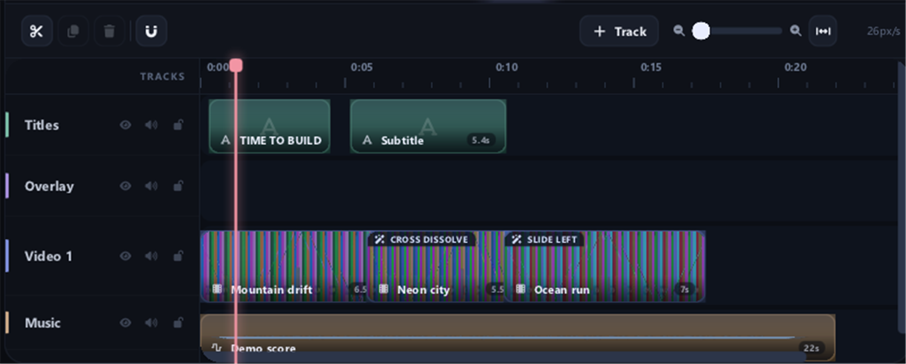
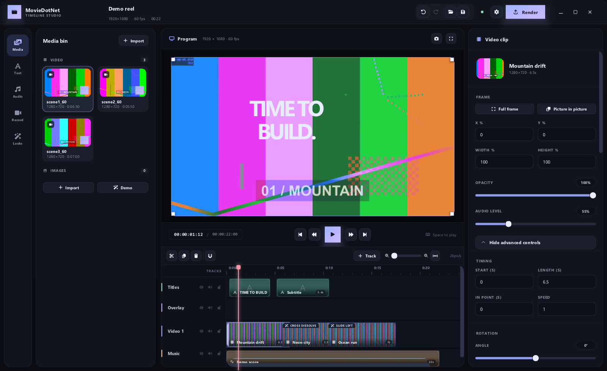
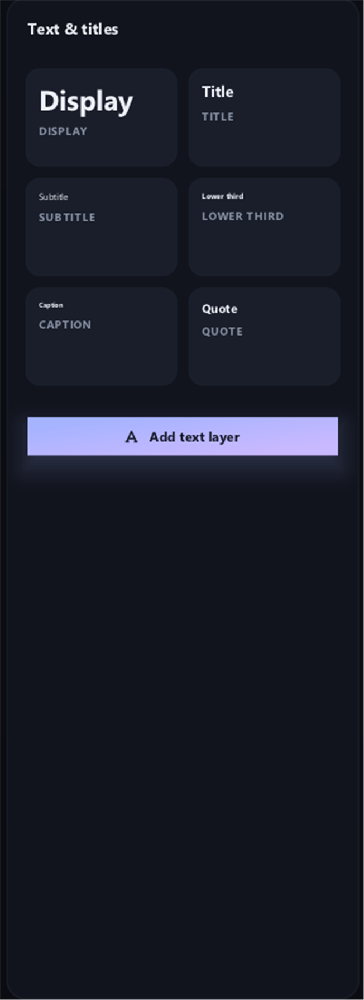
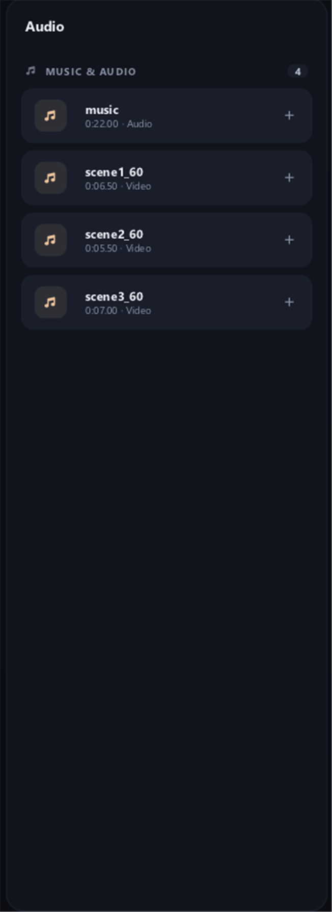
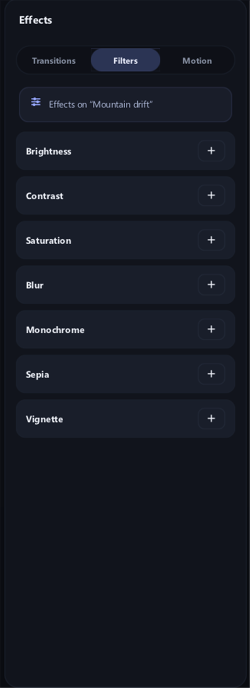
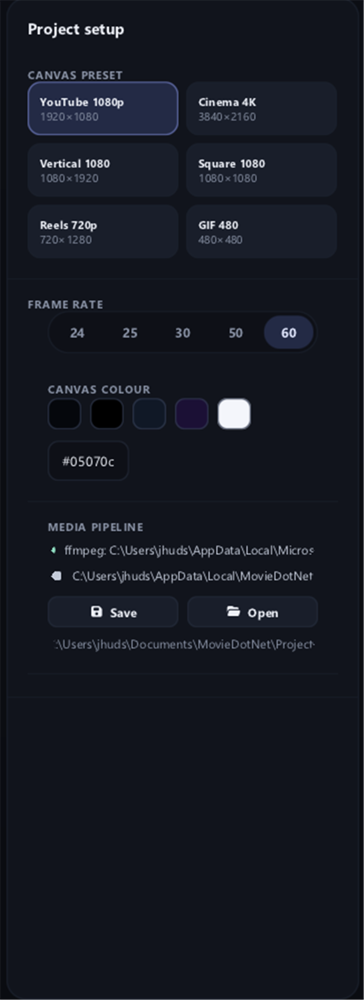

# Editing

The editor is arranged around five rail destinations. Selecting a clip changes
the right-hand inspector; the timeline and Program monitor stay visible.

## Media bin

- **Import** opens the in-app browser. Projects, Renders, Videos, Music,
  Pictures, Downloads and Desktop are one click away.
- **Demo** generates the self-contained demo reel.
- Each card shows a poster, name, resolution and duration.
- Hover a card to reveal **+** (add at the playhead) and the layer button
  (add as a picture-in-picture overlay).
- Drag a card onto a timeline lane to place it at the drop time. Dropping on an
  **Overlay** track creates a picture-in-picture layer.
- Click a card to select its asset for the inspector.

Supported media is MP4, MOV, MKV, WebM, AVI, M4V, WMV, MPEG/TS/MXF, 3GP, OGV,
MP3, WAV, M4A, AAC, FLAC, OGG, Opus, WMA, AIFF and the common image formats.

## Timeline

- Tracks are stored top-to-bottom: text and overlays composite above the base
  video, audio sits below.
- The playhead is the vertical marker. Drag the ruler or the capture surface to
  scrub. The timecode in the transport shows hours, minutes, seconds and frames.
- **Split** cuts every unlocked clip that spans the playhead.
- **Duplicate** places a copy directly after the selected clip.
- **Delete** removes the selected clip.
- **Snap** toggles snapping to clip edges and the playhead.
- The zoom slider and **Fit** control the pixels-per-second scale.
- **+ Track** opens the add-track menu: Video, Overlay, Text or Audio.
- Track headers expose visibility, mute and lock. Locked tracks ignore edits.
- Drag a clip to move it; drag its left or right edge to trim. A clip can move
  between Video and Overlay tracks when the kind matches.
- Transitions overlap neighbouring clips automatically. Choose a transition in
  the inspector or the Looks tab.

## Program monitor

- The canvas is the live composite of the playhead.
- Click a layer to select it. Drag inside the selection to move it; drag an edge
  or corner handle to resize. The handles are real hit targets with resize
  cursors.
- The inspector has **Full frame** and **Picture in picture** presets.
- The camera icon saves the current frame through FFmpeg.
- The expand icon toggles a larger preview.
- The transport has start, second-back, play/pause, second-forward and end.
- Layers are fitted inside their frame, never cropped.

## Inspector

The inspector starts with the controls most edits need:

- **Frame**: X, Y, width and height as percentages of the canvas, plus the two
  framing presets.
- **Opacity**.
- **Audio level** for video, overlay and audio clips.
- **Text** controls for title clips: content, size, weight, colour, alignment.

Press **More controls** for:

- **Timing**: start, length, in point and speed.
- **Rotation**: −180° to +180°.
- **Motion**: enter and exit presets plus animation duration.
- **Transition in**: style and length.
- **Effects**: staged brightness, contrast, saturation, blur, monochrome, sepia
  and vignette with per-effect amounts.

The footer has **Split**, **Duplicate** and **Delete** for the selected clip.

## Text and titles

- The **Text** rail contains Display, Title, Subtitle, Lower third, Caption and
  Quote presets.
- Click a preset to add it at the playhead, or drag it onto a text lane to place
  it at the drop time.
- **Add text layer** creates a blank title.
- Dropped or clicked titles move past an existing title instead of stacking on
  top of it.
- Use the inspector to edit the text, size, weight, colour, alignment, shadow,
  rotation and frame.

## Audio

- The **Audio** rail lists audio assets and video assets that contain sound.
- Click a row to add it at the playhead, or drag it onto an audio lane.
- Use the inspector's **Audio level** slider, or mute a whole track in its
  header.
- The timeline draws waveforms on audio clips.

## Looks

The **Looks** rail groups three sub-tabs:

- **Transitions** — 30+ FFmpeg xfade transitions with a live approximation.
- **Filters** — brightness, contrast, saturation, blur, monochrome, sepia and
  vignette.
- **Motion** — enter and exit animations: fade, slides, scale, zoom, bounce,
  float, spin, blur and wipe.

Select a clip first, then click a transition, filter or motion preset. The
inspector shows the same choices for fine control.

## Drag and drop

- Drag media cards, audio rows or title presets onto the timeline.
- The target lane highlights and a vertical marker shows the drop time.
- Dropping video on a Video track places it full-frame; dropping it on an
  Overlay track creates a picture-in-picture layer.
- Audio only drops on audio tracks; video and images only on video/overlay
  tracks.
- Text can be dropped on any lane and is placed on the text track.
- Overlapping placements are moved to the next free slot; the toast reports the
  actual start time.

## Project setup

Open the gear in the title bar for:

- Canvas presets: YouTube 1080p, Cinema 4K, Vertical 1080, Square 1080,
  Reel 720p, GIF 480.
- Project frame rate: 24, 25, 30, 50 or 60.
- Canvas colour and an optional hex value.
- The FFmpeg pipeline status, cache folder and project folder.
- **Save** and **Open**.

Changing the canvas or frame rate affects the preview, capture canvas and the
next render. Existing media is not retimed.
