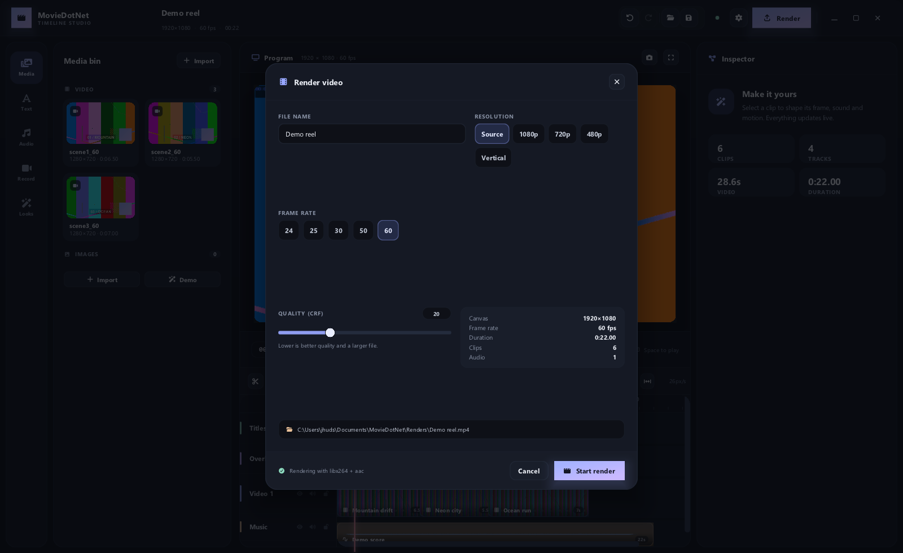

# Export



Press **Render** in the title bar to open the export dialog. Rendering runs in
the background through FFmpeg while the editor stays responsive.

## Settings

| Setting | Meaning |
| --- | --- |
| **File name** | The output name. The `.mp4` extension is added automatically. |
| **Resolution** | Source, 1080p, 720p, 480p or Vertical 1080. The summary shows the exact canvas. |
| **Frame rate** | 24, 25, 30, 50 or 60 fps. |
| **Quality (CRF)** | 14–34; lower is better quality and a larger file. The default is 20. |
| **Summary** | Canvas, frame rate, duration, clip count and audio track count. |
| **Output path** | `Documents/MovieDotNet/Renders/<name>.mp4`. |

## What the render includes

- The base visual track and every overlay/text layer, composited bottom-up.
- Layer frames, opacity, rotation and staged effects.
- Enter/exit animations for fades and slides.
- Incoming transitions using FFmpeg `xfade`.
- Audio levels, muting and the music/voice tracks.
- A canvas-coloured pad for gaps and rotated corners.

The same graph builder is used for the full render and for single-frame
snapshots, so the Program monitor and the export share the same composition
rules.

## Progress and cancellation

- The progress bar follows FFmpeg's `out_time_us` output.
- **Stop render** cancels the process tree and leaves the editor usable.
- **Start render** disables while a render is running.
- Errors and FFmpeg diagnostics are written to the log section and the log stays
  visible when a render fails.

## Frame snapshots

The camera icon in the Program monitor header renders a single PNG of the
current playhead through the same graph:

```
Documents/MovieDotNet/Renders/<project>-frame-<ms>.png
```

## Codec

Exports use `libx264` with AAC audio in an MP4 container. The x264 preset is
`veryfast` and the pixel format is `yuv420p` for broad player compatibility.
