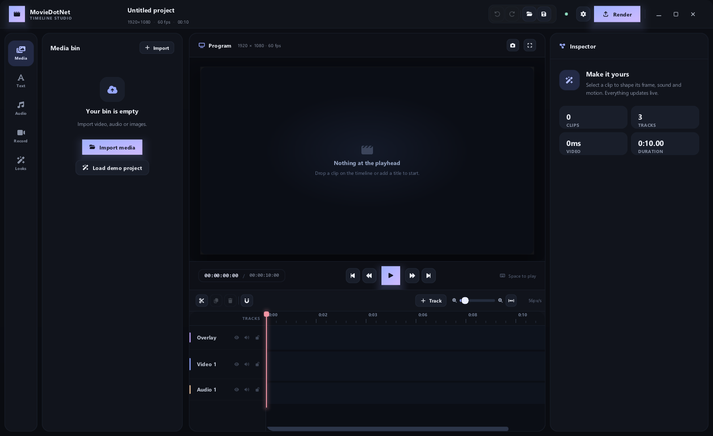

# Getting started

## Download

[**Download the latest MovieDotNet release**](https://github.com/barely-sentient/moviedotnet/releases/latest) **(requires .NET 10 Runtime)**.

Desktop builds are framework-dependent and ship for every supported platform:

| Platform | Release asset | Notes |
| --- | --- | --- |
| Windows x64 | `MovieDotNet-<version>-windows-x64.zip` | Bundled LibVLC. Unzip and run `MovieDotNet.exe`. |
| Linux x64 | `MovieDotNet-<version>-linux-x64.tar.gz` | Requires the distro `libvlc` package. Run `./MovieDotNet`. |
| macOS Intel | `MovieDotNet-<version>-macos-x64.tar.gz` | Bundled LibVLC. Run `./MovieDotNet`. |
| macOS Apple silicon | `MovieDotNet-<version>-macos-arm64.tar.gz` | Bundled LibVLC. Run `./MovieDotNet`. |
| Android | `MovieDotNet-<version>-android.apk` | Sideloadable debug-signed APK; editing and playback only. |

Install the [.NET 10 Runtime](https://dotnet.microsoft.com/download/dotnet/10.0)
for desktop builds. FFmpeg is also required for importing, rendering and (on
Windows) capture.

> Building from source instead? Install the **.NET SDK 10** and run
> `dotnet run -f net10.0` from the repository root.

## Requirements

### Running a desktop release

- **.NET 10 Runtime** — the release is framework-dependent and does not bundle
  the runtime. [Download the runtime](https://dotnet.microsoft.com/download/dotnet/10.0).
- **FFmpeg** and **ffprobe** on `PATH`, next to the app, in `tools/ffmpeg`, or in
  the Winget package cache. On Windows:

  ```powershell
  winget install Gyan.FFmpeg
  ```

  On macOS use `brew install ffmpeg`; on Debian/Ubuntu use
  `sudo apt install ffmpeg`. The app discovers common locations automatically
  and shows its status in the title bar (green dot) and **Project setup** panel.
- **A GPU with OpenGL 3.3**.
- **LibVLC** — bundled on Windows and macOS. On Linux install the distro package:

  ```bash
  sudo apt install libvlc-dev   # Debian/Ubuntu
  sudo dnf install vlc          # Fedora
  ```

### Running Android

- Sideload the APK and allow installation from unknown sources. The APK carries
  its own .NET runtime; no separate .NET install is needed.
- Editing and playback work. Import and render need FFmpeg and are desktop-only;
  capture is Windows-only.

### Building from source

- **.NET SDK 10**.
- **FFmpeg** and **ffprobe** as above.
- **A GPU with OpenGL 3.3**.
- Android (optional): .NET Android workload, Android SDK and JDK. The project
  picks up `%LOCALAPPDATA%\Android\Sdk` and `%LOCALAPPDATA%\Android\Jdk` on Windows.
  Add `-p:DonkehAndroid=true` when building or running the Android target.

## Run a release

### Windows

1. Install the [.NET 10 Runtime](https://dotnet.microsoft.com/download/dotnet/10.0).
2. Download `MovieDotNet-<version>-windows-x64.zip` from the
   [releases page](https://github.com/barely-sentient/moviedotnet/releases/latest).
3. Unzip it and run `MovieDotNet.exe`. The build is unsigned; if SmartScreen
   warns, choose **More info → Run anyway**.

### Linux

1. Install the .NET 10 Runtime and `libvlc`.
2. Download `MovieDotNet-<version>-linux-x64.tar.gz` and extract it.
3. Run `./MovieDotNet`.

### macOS

1. Install the .NET 10 Runtime.
2. Download the asset for your Mac (`macos-x64` or `macos-arm64`) and extract it.
3. Run `./MovieDotNet`. The development build is unsigned; if Gatekeeper blocks
   it, allow it under **System Settings → Privacy & Security**.

### Android

Copy the `.apk` to the device and open it, or use `adb install
MovieDotNet-<version>-android.apk`. Allow installation from unknown sources when
prompted. Release APKs are debug-signed; if Android rejects an update, uninstall
the previous build and install the new one.

On desktop, the app opens frameless with the MovieDotNet title bar. Drag the
title bar to move the window; use the **—**, **□/❐** and **×** buttons at the
far right to minimise, maximise/restore and close. Android keeps the system
window chrome.

## Run from source

```powershell
dotnet run -f net10.0
```

For Android, install the workload and build the Android target with
`dotnet build -f net10.0-android -p:DonkehAndroid=true`.



## First run

1. **Import media** — press **Import** in the media bin. The in-app browser opens
   over the project; choose one or more files and confirm. FFmpeg analyses each
   file and generates a poster, filmstrip and waveform.
2. **Or load the demo** — press **Demo**. The app generates a short demo reel
   with three scenes, a music bed and titles, then shows it in the bin and
   timeline.
3. **Play** — use the transport under the Program monitor or the play button.
4. **Select a clip** — click it on the timeline or in the Program monitor. The
   inspector switches to that clip.
5. **Make a change** — move or trim the clip, adjust opacity, add a title, apply
   a look, or drop an asset onto the timeline.
6. **Save** — use the floppy icon in the title bar or **Project setup → Save**.

## The first screen

| Region | Purpose |
| --- | --- |
| Title bar | Project name, canvas metadata, undo/redo, open/save, FFmpeg status, settings, Render, window controls. |
| Left rail | Media, Text, Audio, Record and Looks destinations. |
| Left panel | The active destination's content. |
| Program monitor | The live composite, transport, timecode and frame snapshot. |
| Timeline | Tracks, clips, playhead, snapping, zoom and fit. |
| Inspector | Frame/opacity/audio first; **More controls** reveals advanced settings. |

## Opening and saving projects

- Projects are JSON files with the `.mdproj` extension in
  `Documents/MovieDotNet/Projects`.
- The folder icon in the title bar opens the project picker.
- The floppy icon saves to the current path, or asks for a name on first save.
- The project name field in the title bar renames the project. The file is only
  written when you save.

## Next steps

- [Editing](editing.md) — the full workflow.
- [Capture](capture.md) — record a screen, window, camera or microphone.
- [Export](export.md) — render the timeline to MP4.
- [Troubleshooting](troubleshooting.md) — if FFmpeg or capture is not detected.
