# Screenshots

These images are captured from the current desktop build. The phone image uses
the desktop host with `MOVIEDOTNET_MOBILE=1`; a real Android device uses the
system frame.

## Editor overview

The demo reel loaded: media bin on the left, Program monitor in the centre,
timeline below, inspector on the right, and the custom frameless title bar with
window controls.

## First launch

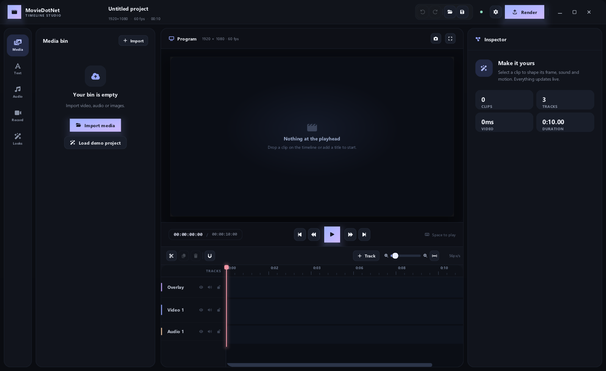

The empty state offers Import media and Load demo project.

## Media bin

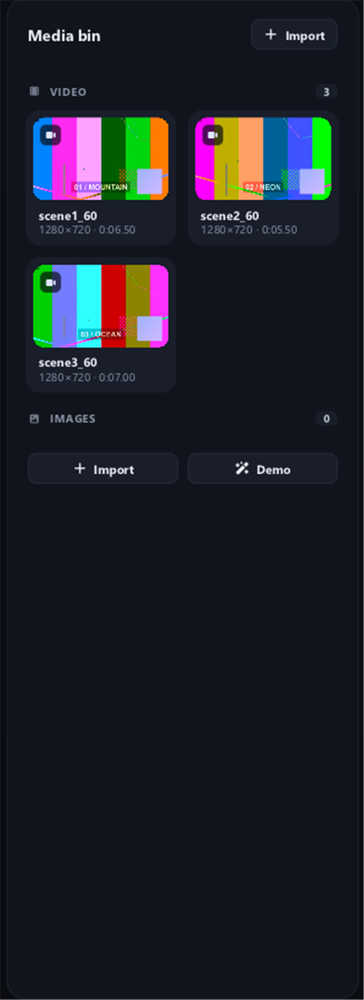

Poster cards, duration, resolution, hover add and picture-in-picture actions.

## Media browser

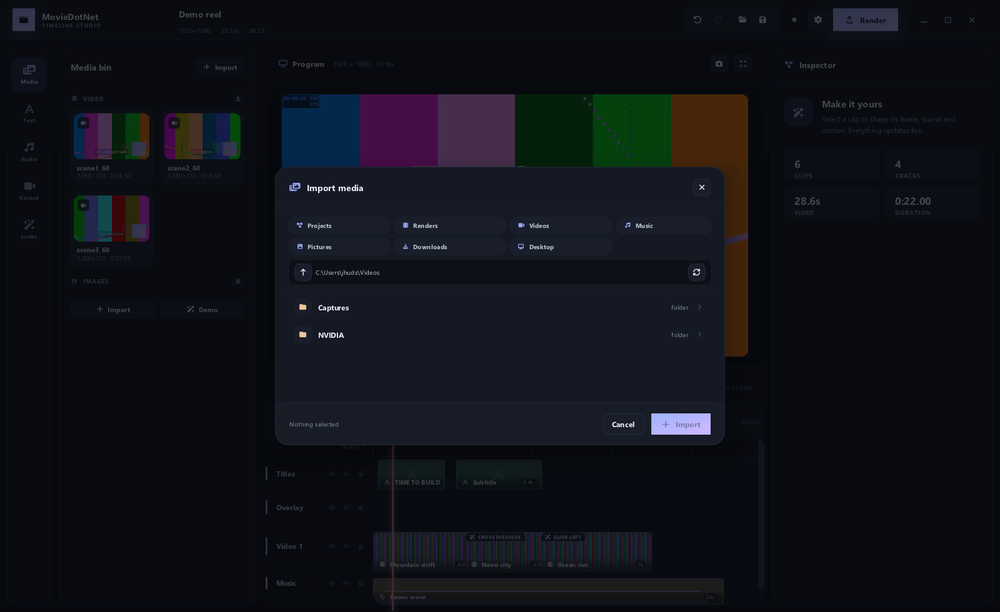

The in-app browser keeps imports inside the editor: projects, renders, videos,
music, pictures, downloads and desktop shortcuts.

## Timeline

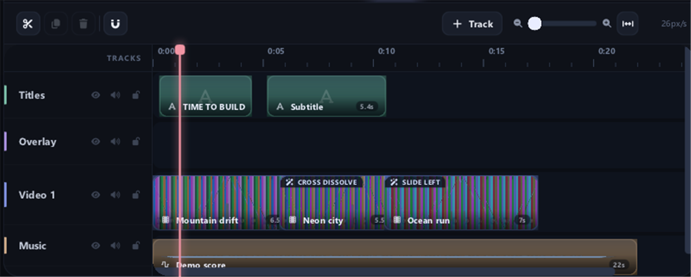

Track headers, ruler, filmstrip and waveform clips, transitions, playhead and
the add-track controls.

## Inspector

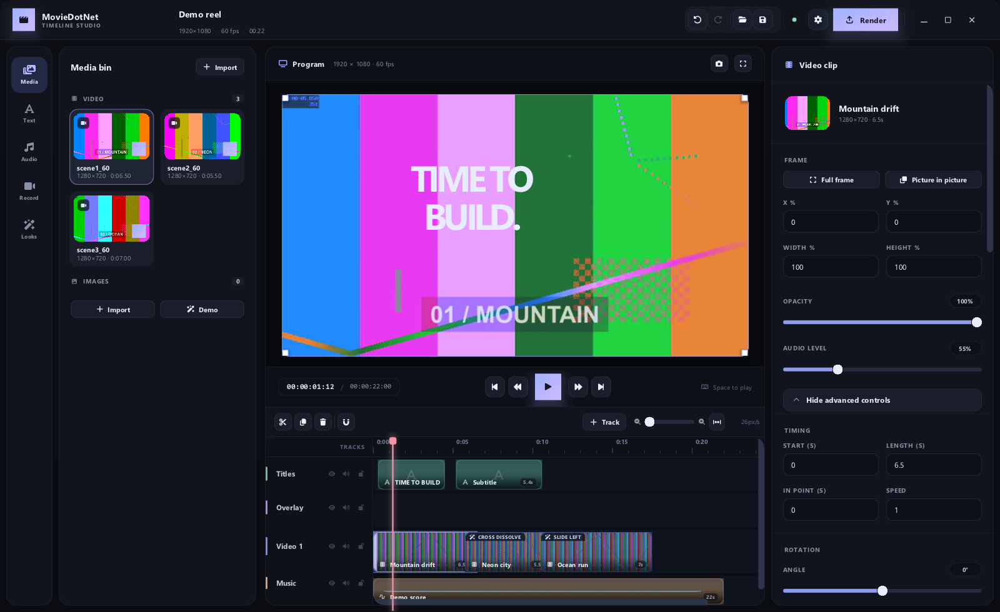

Frame and opacity first, with **More controls** for timing, rotation, motion,
transition and effects.

## Text presets

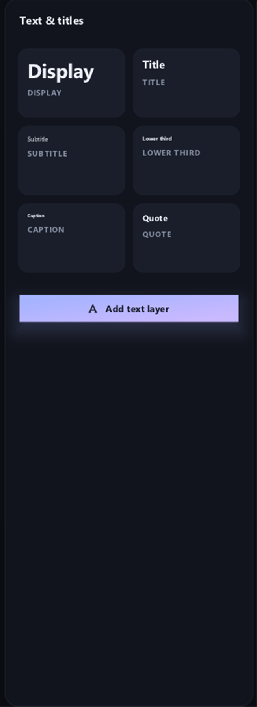

Display, Title, Subtitle, Lower third, Caption and Quote presets.

## Audio

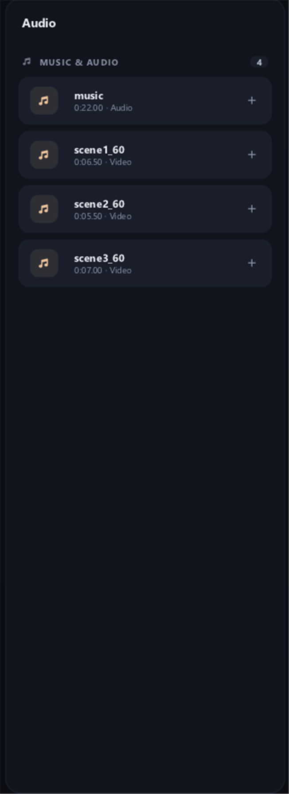

Audio and video-with-sound assets, ready to add or drag onto an audio lane.

## Looks

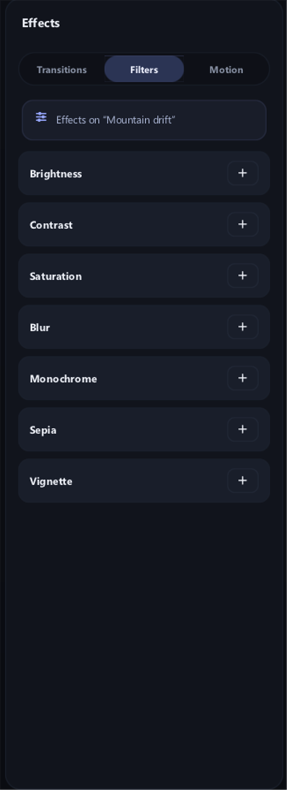

Transitions, filters and motion share one Looks workspace with sub-tabs.

## Record

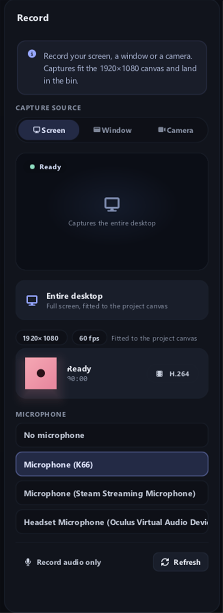

Screen, window and camera sources, microphone selection and the canvas-sized
capture summary.

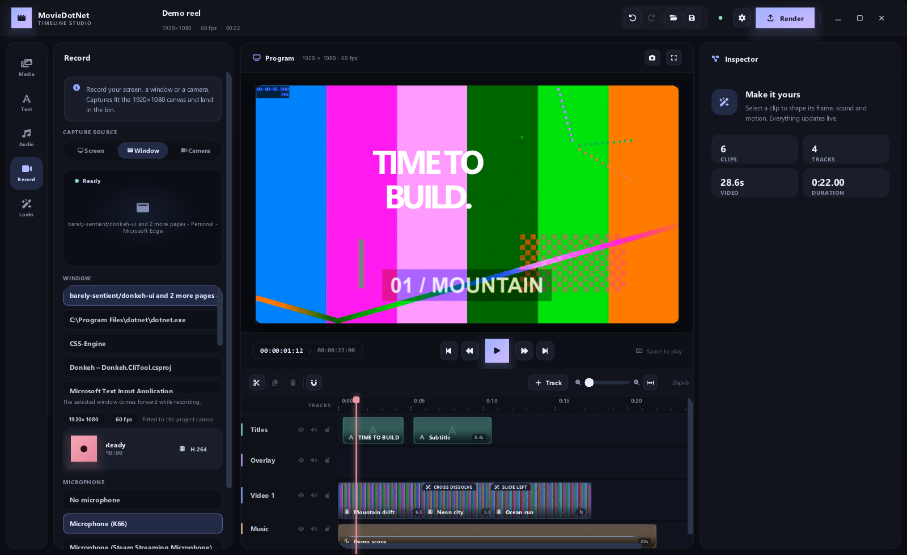

Window capture lists visible top-level windows and brings the chosen one forward.

## Export

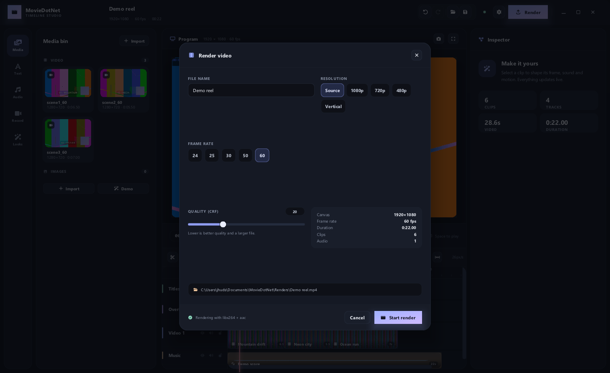

File name, resolution, frame rate, CRF, summary, output path and the render
controls.

## Project setup

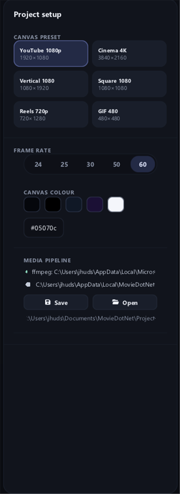

Canvas presets, frame rate, canvas colour, media pipeline status and project
save/open.

## Drag and drop

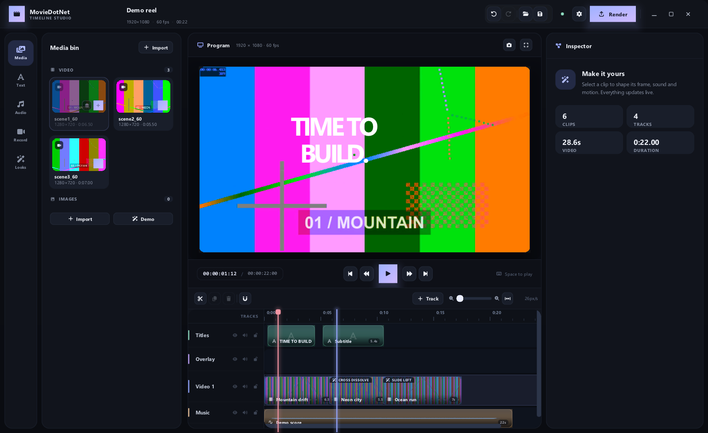

The target lane highlights, the drop marker shows the landing time, and the
source card dims while dragging.

## Frameless window

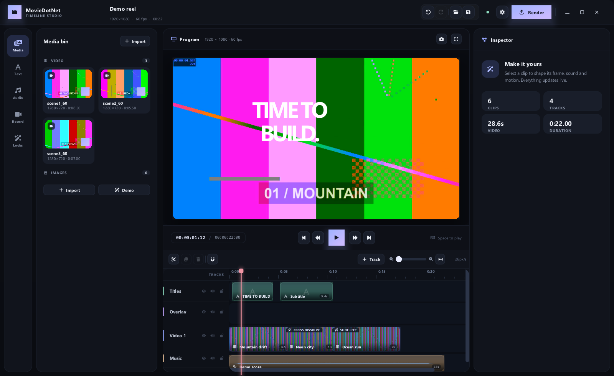

The custom title bar with minimise, maximise/restore and close controls.

## Mobile

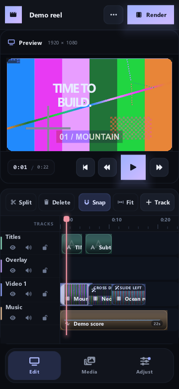

The phone shell with **Edit / Media / Adjust** navigation, a labelled timeline
toolbar and the four-button transport. No desktop window controls are rendered,
and the Android host keeps the system frame.

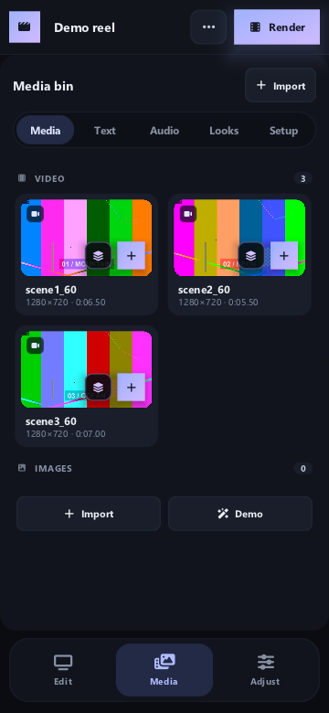

The Media page carries the **Media / Text / Audio / Looks / Setup** tabs, so
every desktop rail destination stays reachable on a phone.
