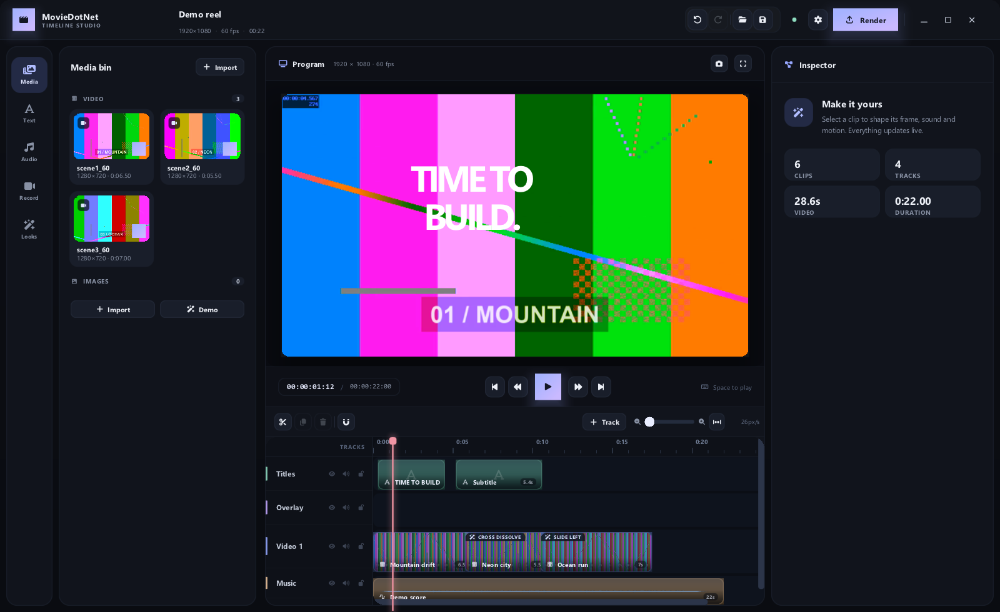
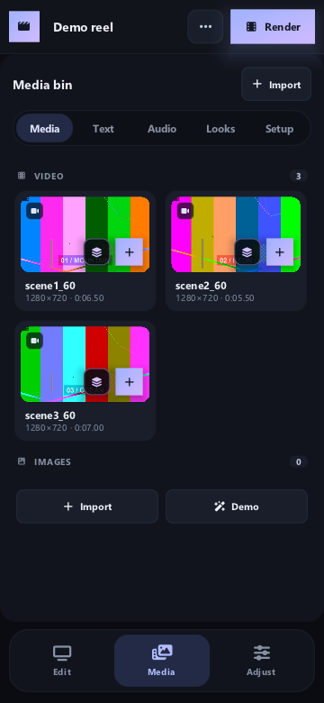

# Window and mobile



## Desktop frameless window

The desktop host is created with `AppRoot(Frameless = true)`. The native frame is
hidden and the app draws the entire title bar:

- **Drag** the brand area or the empty centre of the title bar to move the
  window.
- **—** minimises.
- **□ / ❐** maximises or restores. The icon switches to the restore glyph while
  maximised, and the rounded window corners square off.
- **×** closes the window.

The window is resizable from its edges. The title bar stays draggable because
interactive controls carry `app-region: no-drag`, while the bar itself carries
`app-region: drag`.

The root `.app` uses a 16 px radius. The framework derives the native window
shape from that CSS radius and enables a transparent framebuffer, so the desktop
shows through the rounded corners. The radius is removed when the window is
maximised.

### Mobile and other hosts

The Android host overrides the frameless request with `Frameless = false`,
`Resizable = false` and the system window chrome. The phone bar never renders
the desktop window controls, and its drag region is disabled. `MOVIEDOTNET_MOBILE=1`
is a desktop test shell: it uses the phone UI but the desktop host remains
frameless.

## Phone shell


The phone layout shows one page at a time:

- **Edit** — the preview, a compact transport and the timeline.
- **Media** — the library, with **Media / Text / Audio / Looks / Setup** tabs.
- **Adjust** — the inspector for the selected clip.

A bottom navigation bar switches pages. The preview canvas is sized in viewport
units, the timeline uses taller, touch-sized track rows and the inspector
collapses to one column.

Context menus use the same commands on both hosts: **right-click** on desktop
and **long-press** on Android. Timeline clips offer Cut, Copy, Paste, Duplicate,
Split and Delete; media cards offer Add to timeline and picture-in-picture;
track headers offer mute, hide, lock and clear. The phone menu opens as a bottom
sheet, while the desktop menu anchors beside the pointer.

The phone shell is deliberately simpler than the desktop docks:

- The transport keeps play, one-second steps and go-to-start; start/end jumps
  and the keyboard hint are desktop-only.
- Timeline tools carry text labels (**Split**, **Delete**, **Snap**, **Fit**,
  **Track**) instead of relying on small icons, and the zoom slider is replaced
  by **Fit**.
- The **⋯** button opens a bottom sheet with Save, Open, Undo, Redo and Project
  setup. **+ Track** opens the same sheet with the four track kinds.
- The preview's empty state offers **Add media** and **Title** so a new project
  can start without a drag gesture.
- Toasts sit above the bottom navigation, and the timeline body scrolls
  vertically when a project has more tracks than fit on screen.



Import, analysis and render need FFmpeg and are unavailable on Android;
recording is Windows-only. On a phone the media bin therefore offers **Open
project** and **Add a title** when FFmpeg is not present, and the Export dialog
explains that rendering runs on the desktop build.

## Window actions

The framework exposes window actions for custom title bars:

```csharp
using Donkeh.Windowing;

WindowChrome.Minimize();
WindowChrome.ToggleMaximize();
WindowChrome.Close();
var maximized = WindowChrome.IsMaximized;
```

The calls are no-ops on hosts without a native window. See
[Framework changes](framework-changes.md#8-window-actions-for-app-drawn-title-bars).
