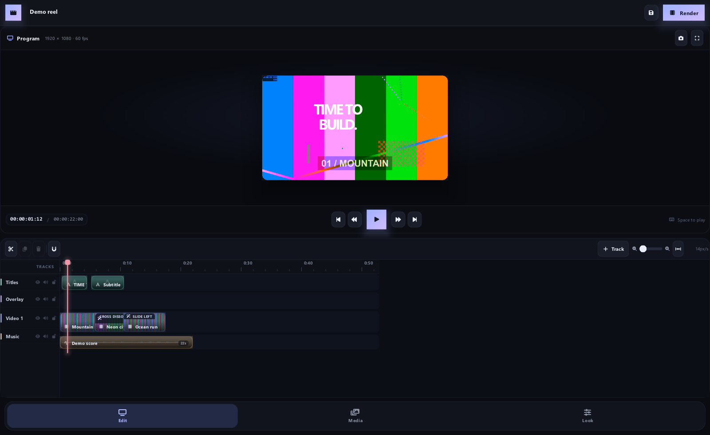

# Window and mobile


## Desktop frameless window

The desktop host is created with `AppRoot(Frameless = true)`. The native frame is
hidden and the app draws the entire title bar:

- **Drag** the brand area or the empty centre of the title bar to move the
  window.
- **—** minimises.
- **□ / ❐** maximises or restores. The icon switches to the restore glyph while
  maximised, and the rounded window corners square off.
- **×** closes the window.

The window is resizable from its edges. The title bar stays draggable because
interactive controls carry `app-region: no-drag`, while the bar itself carries
`app-region: drag`.

The root `.app` uses a 16 px radius. The framework derives the native window
shape from that CSS radius and enables a transparent framebuffer, so the desktop
shows through the rounded corners. The radius is removed when the window is
maximised.

### Mobile and other hosts

The Android host overrides the frameless request with `Frameless = false`,
`Resizable = false` and the system window chrome. The phone bar never renders
the desktop window controls, and its drag region is disabled. `MOVIEDOTNET_MOBILE=1`
is a desktop test shell: it uses the phone UI but the desktop host remains
frameless.

## Phone shell



The phone layout shows one page at a time:

- **Edit** — the Program monitor above the timeline.
- **Media** — the media bin, text, audio and Looks destinations.
- **Look** — the inspector.

A bottom navigation bar switches pages. The preview canvas is sized in viewport
units, the timeline uses compact track rows and the inspector collapses to one
column. Import, recording, analysis and render are desktop-only because they
depend on FFmpeg and ffprobe.

## Window actions

The framework exposes window actions for custom title bars:

```csharp
using Donkeh.Windowing;

WindowChrome.Minimize();
WindowChrome.ToggleMaximize();
WindowChrome.Close();
var maximized = WindowChrome.IsMaximized;
```

The calls are no-ops on hosts without a native window. See
[Framework changes](framework-changes.md#8-window-actions-for-app-drawn-title-bars).
